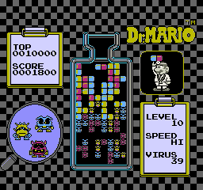
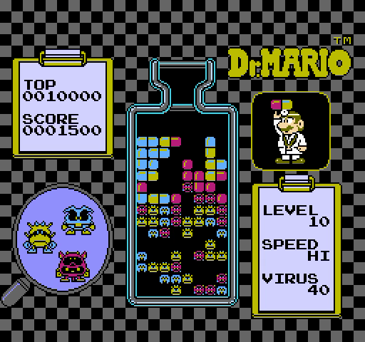
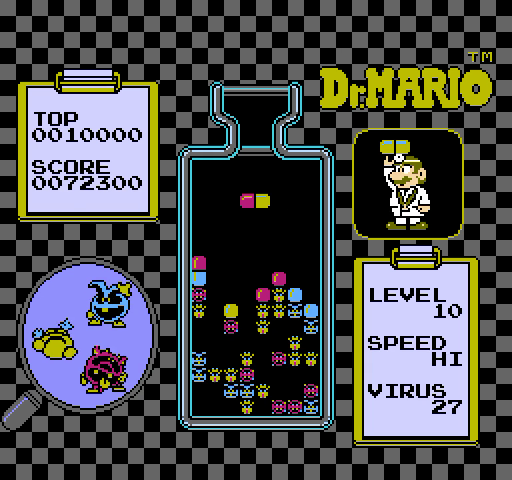
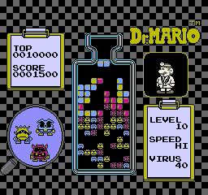
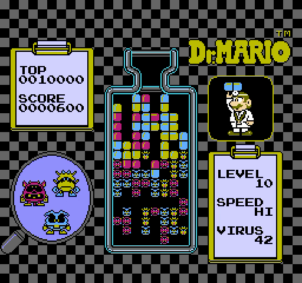
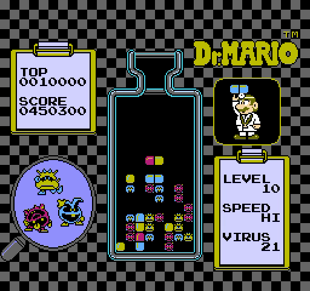
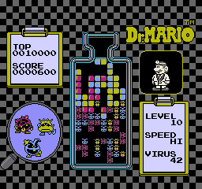
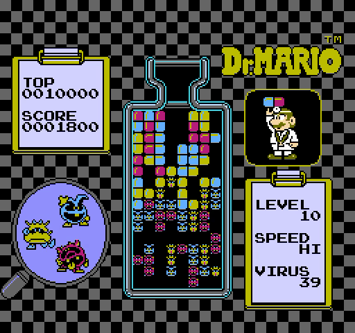
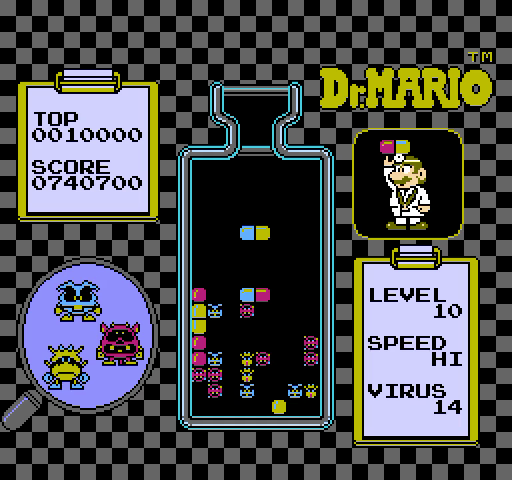

# DrMarioComboFinder 💊

**Finds the biggest single-pill combos in NES Dr. Mario that don't break the game: searched outside the game, proven in Mesen 2.**

## Why

In NES Dr. Mario, one pill can set off a cascade that clears virus after virus, and each kill pays a
multiplier that depends on how many came before it in the combo (up to ×256). Long cascades run into two bugs: the frame's NMI can interrupt the game while it
is clearing a match, and then either the game's `fieldPos_last` (`$49`) gets player 2's buttons written into
it, or a metasprite pointer gets changed. Either one can wreck the board or freeze the game. A third, milder
one draws the virus counter wrong (old tens digit, new ones digit) until the next kill. This project
looks for the biggest combos that **don't** set any of them off, by score and by number of viruses, and
proves each one in an emulator.

## The records

All on level 10, speed HI, music off, NTSC PRG0 ROM. Each was played in Mesen 2 from power-on with every
pill landing where the plan says, the board matching the simulator after every pill, and no glitch
firing. "Kills" are the viruses that one last pill clears; the points are that pill's.

The first bug can be fixed from the second controller: if player 2 holds the value the game is about to
need, the bad write changes nothing. Whether that counts is up to you, so there are three leaderboards:

| Category | Seed (RNG index) | Pills | Kills | Points | Player 2 holds | Plan | Video |
|---|---|---|---|---|---|---|---|
| No controller 2 | 31 | 23 | **13** | 70,800 | – | [`best/nop2_13.plan`](best/nop2_13.plan) | [MP4](videos/nop2_13.mp4) |
| Player 2, standard pad only | 154 | 59 | **21** | 449,700 | `$75 $5A $58 $70` | [`best/pad_21.plan`](best/pad_21.plan) | [MP4](videos/pad_21.mp4) |
| Player 2, any value | 154 | 48 | **25** | 738,900 | `$5D $44 $5E $5E $5A $85 $85 $76 $76` | [`best/any_25.plan`](best/any_25.plan) | [MP4](videos/any_25.mp4) |

Without a second controller, 13 kills is the hard cap: the 14th kill pays ×256, and adding up that score
takes so long that an NMI is sure to land in the middle of the clear.
"Standard pad" means values a real controller can produce (no Left+Right or Up+Down together).

### No controller 2: 13 kills

| Just before the last pill lands | After the cascade |
|---|---|
|  |  |

### Player 2, standard pad: 21 kills

| Just before the last pill lands | After the cascade |
|---|---|
|  |  |

### Player 2, any value: 25 kills

| Just before the last pill lands | After the cascade |
|---|---|
|  |  |

Earlier records (pad 20, any 23, any 24) are still in [`best/`](best/README.md) and `videos/`.

The GIFs are cut from the full videos, which show the whole game from power-on. Plan and input-log formats
are in [`best/`](best/README.md).

## Usage

You need your own legally obtained Dr. Mario ROM (NTSC, PRG0) saved as `drmario.nes` in the repo root,
and [Mesen 2](https://www.mesen.ca/) in `mesen/` (`mesen/Mesen.exe`). **No ROM or emulator is included.**
Python 3.12 (standard library only); for the search engine, Visual Studio 2022 (C++); for videos, `ffmpeg`
on the PATH.

    engine\build.bat                                   # build engine\dm.exe
    python tools/check_engine.py                       # engine agrees with the Python model
    engine\dm.exe search level=10 n0=150 n1=160 depth=80 beam=2000 shape=0.25 look=2 min=16 per=20 > scan.jsonl
    python tools/batch_new.py 19 4 out/batch.jsonl scan.jsonl
    python tools/try_many.py out/batch.jsonl mybatch 8  # play the best candidates in Mesen
    powershell tools\make_video.ps1 out\mybatch_0.inputs out\mybatch_0.mp4

To watch a record, replay its input log: `DRM_INPUTS=best/any_25.inputs` and run
`mesen/Mesen.exe --testRunner lua/replay.lua drmario.nes`, or make a video with `tools/make_video.ps1`.

## How it works

1. **The game, rebuilt in Python** (`drm/`). Level generation and the RNG (`gen.py`) reproduce every
   virus layout and pill list from an RNG index; the board model (`board.py`, `plan.py`) does landings,
   clears, cascades and scoring. Both were built from a disassembly and checked against Mesen.
2. **Search by placement, not by play.** A pill's move is just where it ends up: rotation and column.
   The search drops it, resolves the board, and scores it. A beam search (`engine/dm.cpp`, C++ with OpenMP)
   builds up a board over dozens of pills so that one last pill sets off the biggest cascade it can.
3. **Glitch timing.** `drm/glitch.py` runs the game's own match routines on a 6502 core (`drm/cpu6502.py`)
   with the real RAM, and works out whether the frame's NMI can land inside a clear loop
   (`tools/sprite_check.py` does the same for the metasprite updates after it). For the
   player-2 categories it also works out which value player 2 must hold, and whether a standard pad can
   hold it.
4. **Mesen is the judge.** `lua/play_plan.lua` starts the level at the chosen RNG index, steers each pill to
   its spot and logs every frame's inputs. `tools/prove.py` checks each pill against the model and counts
   all three glitches. Only combos that pass go on the board. `lua/replay.lua` replays the log for the video.

Everything learned about the game along the way (RNG, generation, scoring, RAM map, the two glitches, the
timing model) is in [`RESEARCH.md`](RESEARCH.md).

## Layout

- `drm/`: Python model of the game (generation, board, placement search, 6502 core, glitch timing).
- `engine/`: C++ search engine (`dm.cpp`, `build.bat`).
- `lua/`: Mesen scripts (play a plan, replay, probes).
- `tools/`: pipeline and check scripts.
- `best/`: record plans and input logs. `docs/img/`, `videos/`: stills, GIFs, videos.
- `RESEARCH.md`: research notes. `docs/status.md`: what's built and what's next.

## Contributing

This is a personal tool, published as-is, and doesn't take issues or pull requests. Fork it and make it your own. 💊

## License

MIT — see [LICENSE](LICENSE). © 2026 RelentlessOldMan.

Dr. Mario is a trademark of Nintendo. This project is not affiliated with or endorsed by Nintendo or the
Mesen project.
